<div align="center">

<!-- ANIMATED WAVING BANNER -->


<!-- TYPING ANIMATION -->


<br/>

<!-- ROTATING QUOTE -->


<br/><br/>

<!-- QUICK LINKS & PROFILE VIEWS -->
[](https://kartiktiwartiportfolio.netlify.app/)
[](https://www.linkedin.com/in/kartik-tiwari-8b2bb5353/)
[](mailto:kartiktiwaridev7@gmail.com)
[](https://github.com/kartiktiwaridev7)

</div>


## 👋 About Me



**Currently building:** [Data-Sight](https://github.com/kartiktiwaridev7/Data-Sight) — a full-stack AI analytics engine
<br/>
**Core architecture:** React & Vanilla JS frontends powered by FastAPI & Scikit-Learn backends

- 🔭 Building the bridge between **ML models** and **frontend engineering**
- 📈 Deepening skills in **data preprocessing, model evaluation & interactive visualization**
- 🎓 Wrapping up my **BCA**, aiming for a role at the intersection of frontend engineering and applied ML
- 🤝 Open to collaborating on open-source **data/ML** or **frontend** projects

```python
class KartikTiwari:
    def __init__(self):
        self.name      = "Kartik Tiwari"
        self.location  = "Ghaziabad, India 🇮🇳"
        self.education = "BCA Final Year"
        self.role      = "Frontend Dev + ML Learner"
        self.frontend  = ["React", "JavaScript", "HTML5", "CSS3"]
        self.backend   = ["Python", "FastAPI", "Scikit-Learn", "MySQL"]

    def hobbies(self):
        return ["Meditation 🧘", "Book Reading 📚"]

    def motto(self):
        return "One commit at a time"

me = KartikTiwari()
```

> *"Bridging data-driven technologies with interactive web experiences — one commit at a time."*

<br clear="right"/>

<div align="center">



</div>

## 🛠️ Tech Stack

<div align="center">

**Data Science & Machine Learning**
<br/>


**Frontend & Backend Web Development**
<br/>


**Languages, Databases & Tools**
<br/>


</div>

## 📊 GitHub Analytics

<div align="center">


<br/>


</div>

### 🐍 Contribution Snake

<div align="center">

<picture>
  <source media="(prefers-color-scheme: dark)" srcset="https://raw.githubusercontent.com/kartiktiwaridev7/kartiktiwaridev7/output/github-contribution-grid-snake-dark.svg">
  <source media="(prefers-color-scheme: light)" srcset="https://raw.githubusercontent.com/kartiktiwaridev7/kartiktiwaridev7/output/github-contribution-grid-snake.svg">
  
</picture>

</div>

## 📌 Pinned Projects

<div align="center">

<table width="100%">
<tr>
<td width="50%" valign="top" align="center">

### 🩺 [CardioCore-Backend](https://github.com/kartiktiwaridev7/CardioCore-Backend)

FastAPI + ML backend for CardioCore. Serves real-time heart-disease risk predictions from a trained Scikit-Learn classification model and manages secure clinical records via MySQL.


**[View Repository →](https://github.com/kartiktiwaridev7/CardioCore-Backend)**

</td>
<td width="50%" valign="top" align="center">

### 🌐 [CardioCore-Frontend](https://github.com/kartiktiwaridev7/CardioCore-Frontend)

Responsive clinical risk-assessment UI for CardioCore, built in Vanilla JavaScript, featuring interactive health parameter inputs and a secure appointment-booking flow connected to the FastAPI backend.


**[View Repository →](https://github.com/kartiktiwaridev7/CardioCore-Frontend)**

</td>
</tr>
<tr>
<td colspan="2"></td>
</tr>
<tr>
<td width="50%" valign="top" align="center">

### 💼 [My-Portfolio-2](https://github.com/kartiktiwaridev7/My-Portfolio-2)

Personal developer portfolio showcasing projects, skills, certifications, resume, and contact details — engineered for clean UI and full mobile responsiveness.


**[Live Demo →](https://kartiktiwartiportfolio.netlify.app/)** &nbsp;|&nbsp; **[View Repository →](https://github.com/kartiktiwaridev7/My-Portfolio-2)**

</td>
<td width="50%" valign="top" align="center">

### 🎓 [College-Project](https://github.com/kartiktiwaridev7/Collage-Project)

Academic college project built with HTML, CSS, and JavaScript — implemented as an interactive student attendance management and tracking system.


**[View Repository →](https://github.com/kartiktiwaridev7/Collage-Project)**

</td>
</tr>
<tr>
<td colspan="2"></td>
</tr>
<tr>
<td width="50%" valign="top" align="center">

### 📊 [Data-Sight](https://github.com/kartiktiwaridev7/Data-Sight)

Full-stack AI analytics engine. A responsive React/Vite frontend that streams datasets to a Python/FastAPI backend for real-time ML regression, dynamic data aggregation, and interactive visualization.


**[View Repository →](https://github.com/kartiktiwaridev7/Data-Sight)**

</td>
<td width="50%" valign="top" align="center">

### ⚙️ [Data-Sight-Backend](https://github.com/kartiktiwaridev7/Data-Sight)

Python/FastAPI ML backend for the DataSight dashboard. Securely processes large datasets, runs multi-variable regressions, and streams aggregated time-series insights.


**[View Repository →](https://github.com/kartiktiwaridev7/Data-Sight)**

</td>
</tr>
</table>

<sub>🔎 <a href="https://github.com/kartiktiwaridev7?tab=repositories">View all repositories →</a></sub>

</div>

## 🎓 Currently Exploring

<div align="center">


</div>

## 🤝 Let's Connect

<div align="center">

I'm always up for a conversation about **ML, frontend engineering, or a good book** 📚 — feel free to reach out!

[](https://www.linkedin.com/in/kartik-tiwari-8b2bb5353/)
[](mailto:kartiktiwaridev7@gmail.com)
[](https://kartiktiwartiportfolio.netlify.app/)

⭐ **Star my repos if you find them useful — let's build something amazing together!**


</div>
